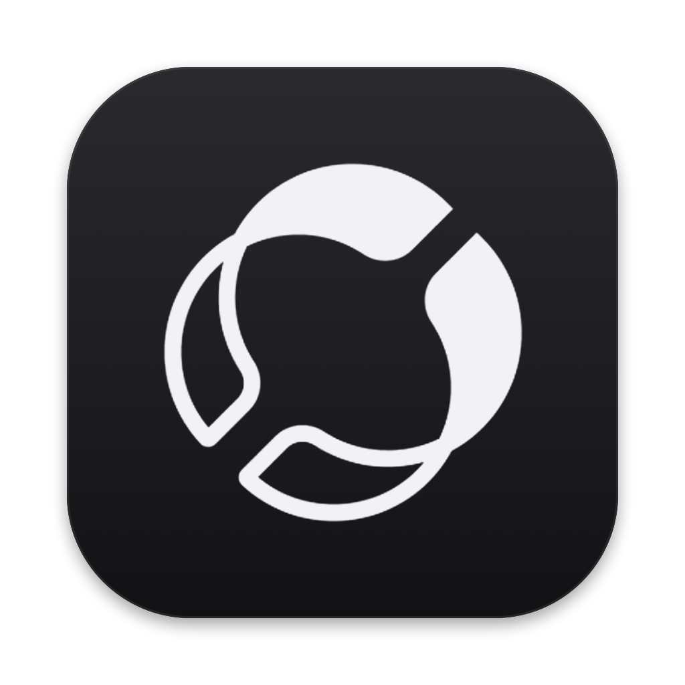

# Hyperlayer



**[royxue.github.io/hyperlayer](https://royxue.github.io/hyperlayer)**

A tiny macOS menu bar app that turns Caps Lock into a Hyper key (Cmd+Ctrl+Opt+Shift) with a built-in navigation layer.

Works the same on built-in and external keyboards, without seizing any device, so media keys and everything else on your keyboard keep working.

## Navigation layer

Hold Caps Lock and press:

| Key | Action |
|-----|--------|
| `H` `J` `K` `L` | ← ↓ ↑ → |
| `;` / `'` | Word back / forward (Opt+←/→) |
| `I` / `O` | Line start / end (Cmd+←/→) |
| `U` / `P` | Page Up / Page Down |
| `Space` | Ctrl+Space (switch input source) |
| `Esc` | Toggle Caps Lock |

Physical modifiers are kept, so Caps Lock+Shift+H selects to the left. Every other key is sent as Hyper+key, ready for Raycast, Alfred, or app shortcuts.

The layer can be turned off from the menu if you only want a plain Hyper key.

## Menu options

- **Key Mapping…**: shows the layer as a floating cheat sheet in the middle of the screen (Esc or click away to close)
- **Navigation Layer**: enable or disable the layer above
- **Tap Caps Lock for Escape**: a quick tap without another key sends Escape
- **Keyboards**: the keyboards Caps Lock is currently remapped on
- **Launch at Login**

## Install

Requires macOS 13 or later.

**Download**: grab [Hyperlayer.zip](https://github.com/royxue/hyperlayer/releases/latest/download/Hyperlayer.zip) from the latest release, unzip it and move Hyperlayer to Applications. The app is not notarized, so the first time you open it macOS will block it: go to System Settings → Privacy & Security and click **Open Anyway**.

**From source** (needs Xcode command line tools):

```bash
make install
```

This builds the app, installs it to `/Applications/Hyperlayer.app` and launches it.

Either way, grant Accessibility access when asked (System Settings → Privacy & Security → Accessibility). Hyperlayer starts working as soon as access is granted.

```bash
make uninstall
```

Quitting Hyperlayer restores Caps Lock to normal on every keyboard.

## How it works

1. **Remap**: Caps Lock is remapped to F18 on every keyboard through the HID event system (the same `UserKeyMapping` property `hidutil` sets). The mapping is applied per keyboard, re-applied when a keyboard connects or the Mac wakes, and checked every few seconds in case the system drops it.
2. **Hyper**: one `CGEventTap` sees F18 down/up from every keyboard. While F18 is held, layer keys are rewritten and every other key gets the four modifiers added.

## Troubleshooting

- **Nothing happens**: check the menu for an Accessibility warning. After rebuilding, `make install` resets the old grant, so macOS asks again.
- **Works except in password fields**: macOS turns on Secure Input in password fields and some terminals, which blocks all key remapping apps. The menu shows a warning while it is on.
- **Logs**: run `/Applications/Hyperlayer.app/Contents/MacOS/Hyperlayer` from a terminal to see them.

## License

MIT
